<p align="center"></p>

<p align="center">
  <a href="https://github.com/pamteech"></a>
</p>

<p align="center">
  
  
</p>

<p align="center"></p>

## 👾 Oi, eu sou a Pam

Sou **Pamella Soares**, QA de coração e de profissão: meu trabalho é achar o bug antes que ele ache você.
Fora do expediente eu transformo hiperfoco em projetos: **pets em pixel art**, apps de foco que parecem videogame e muita **IA aplicada no dia a dia**.
Autista + TDAH, com orgulho, e é por isso que gosto de ferramentas que respeitam cérebros diferentes.

<p align="center"></p>

## 🧾 Relatório de testes: Pam

```js
$ npx pam-test --reporter=verbose

 PASS  pam.spec.ts
  describe('Pam como QA')
    ✔ encontra o bug antes do usuário (12ms)
    ✔ reproduz "na minha máquina funciona" em outra máquina (48ms)
    ✔ escreve passo a passo que até o dev entende (7ms)
  describe('Pam + IA')
    ✔ usa IA na vida real, não só no slide (21ms)
    ✔ desconfia de resposta confiante demais (3ms)
  describe('Pam e os pets')
    ✔ SatoshiPet sobrevive a mais um dia sem morrer de fome (16ms)
    ✔ Pilinha e Onedayzinho moram no notch sem pagar aluguel (9ms)
    ✔ Save Point salva o progresso (e o foco) (30ms)
  describe('Pam: Autista + TDAH')
    ✔ hiperfoco ativado com sucesso (∞ms)
    ✔ abre 37 abas e lembra de todas (5ms)
    ○ skipped: tarefa chata sem prazo

Tests:  10 passed, 1 skipped, 0 failed
Time:   cafeína-dependente ☕
```

<p align="center"></p>

## 🛠️ O que estou construindo

<table>
<tr>
<td width="50%" valign="top">
<h3>🥚 SatoshiPet</h3>
Tamagoshi cripto: um bichinho em pixel art que vive no seu desktop e pede carinho (e satoshis).<br/><br/>
 
</td>
<td width="50%" valign="top">
<h3>🎮 Save Point</h3>
App de foco com cara de videogame, feito para cérebros com TDAH: cada tarefa é uma fase, cada pausa é um checkpoint.<br/><br/>

</td>
</tr>
<tr>
<td width="50%" valign="top">
<h3>🍡 Pilinha</h3>
Um pet que mora no entalhe (notch) do Mac e reage ao que você está fazendo.<br/><br/>

</td>
<td width="50%" valign="top">
<h3>🌱 Onedayzinho</h3>
Mais um morador do notch, nativo e caprichado nos detalhes.<br/><br/>
 
</td>
</tr>
</table>

<p align="center"></p>

## 🧪 Ferramentas do dia a dia

**Qualidade & testes**<br/>


**Dev**<br/>


<p align="center"></p>

## 📊 Placar

<p align="center">
  
  
</p>

<p align="center">
  <picture>
    <source media="(prefers-color-scheme: dark)" srcset="https://raw.githubusercontent.com/pamteech/pamteech/output/snake-dark.svg" />
    <source media="(prefers-color-scheme: light)" srcset="https://raw.githubusercontent.com/pamteech/pamteech/output/snake-light.svg" />
    
  </picture>
</p>

<p align="center"></p>

<p align="center"><sub>🐞 Se compila, eu testo. Se quebra, eu conto. Se fica lindo, eu comemoro.</sub></p>
<p align="center"></p>
