<p align="center"></p>

<p align="center">
  <a href="https://github.com/pamteech"></a>
</p>

<p align="center">
  
  
</p>

<p align="center"></p>

## 👾 Oi, eu sou a Pam

Sou **Pamella Soares**, QA de coração e de profissão: meu trabalho é achar o bug antes que ele ache você.
Fora do expediente eu transformo hiperfoco em projetos: **pets em pixel art**, apps de foco que parecem videogame e muita **IA aplicada no dia a dia**.
Autista + TDAH, com orgulho, e é por isso que gosto de ferramentas que respeitam cérebros diferentes.

<p align="center"></p>

## 🧾 Relatório de testes: Pam

```js
$ npx pam-test --reporter=verbose

 PASS  pam.spec.ts
  describe('Pam como QA')
    ✔ encontra o bug antes do usuário (12ms)
    ✔ reproduz "na minha máquina funciona" em outra máquina (48ms)
    ✔ escreve passo a passo que até o dev entende (7ms)
  describe('Pam + IA')
    ✔ usa IA na vida real, não só no slide (21ms)
    ✔ desconfia de resposta confiante demais (3ms)
  describe('Pam e os pets')
    ✔ SatoshiPet sobrevive a mais um dia sem morrer de fome (16ms)
    ✔ Pilinha e Onedayzinho moram no notch sem pagar aluguel (9ms)
    ✔ Save Point salva o progresso (e o foco) (30ms)
  describe('Pam: Autista + TDAH')
    ✔ hiperfoco ativado com sucesso (∞ms)
    ✔ abre 37 abas e lembra de todas (5ms)
    ○ skipped: tarefa chata sem prazo

Tests:  10 passed, 1 skipped, 0 failed
Time:   cafeína-dependente ☕
```

<p align="center"></p>

## 🛠️ O que estou construindo

<table>
<tr>
<td width="50%" valign="top">
<h3>🪙 Treino &amp; Diário Cripto</h3>
Web app de estudo, em português, com modo Treino (carteira de teste na Sepolia e 5 missões) e modo Diário de DCA em bitcoin, só leitura.<br/><br/>
   <br/><br/>
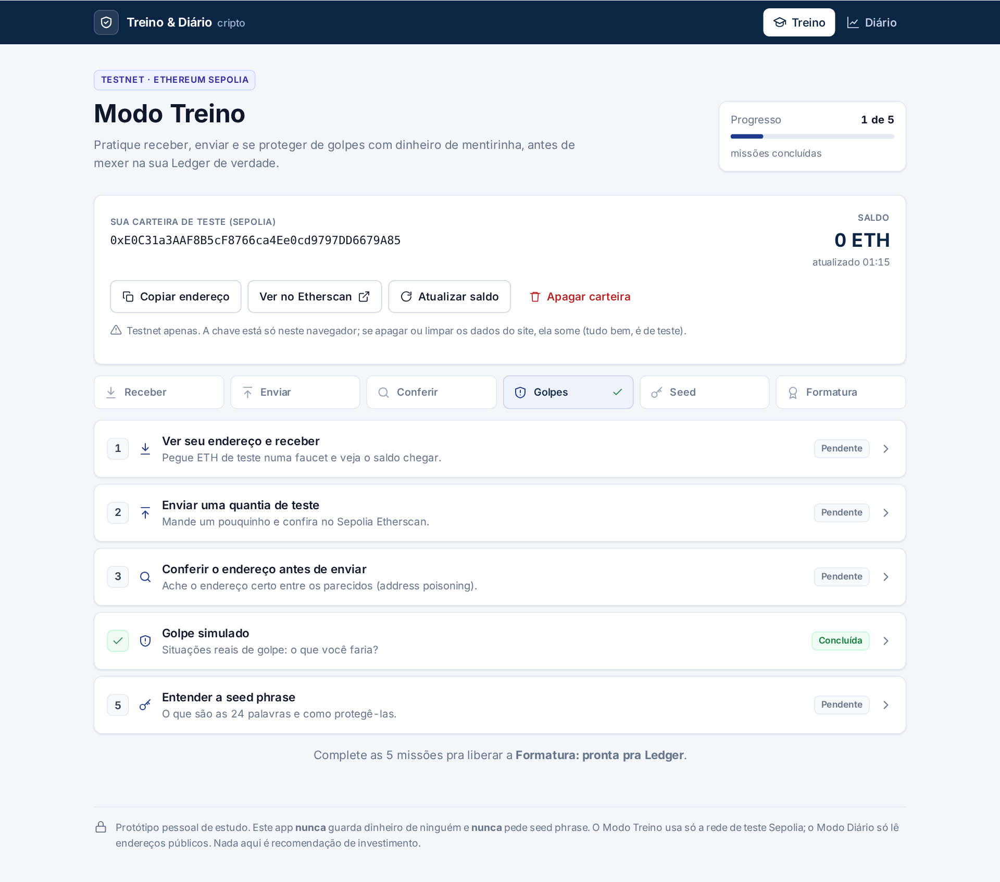<br/><a href="https://cripto-treino-diario.vercel.app">Ver demo</a>
</td>
<td width="50%" valign="top">
<h3>🍡 Pilinha</h3>
Porquinho que mora no entalhe do Mac e acompanha investimentos (renda fixa pelo CDI, ações e FIIs da B3 e bitcoin), só leitura, com dados locais.<br/><br/>
    <br/><br/>
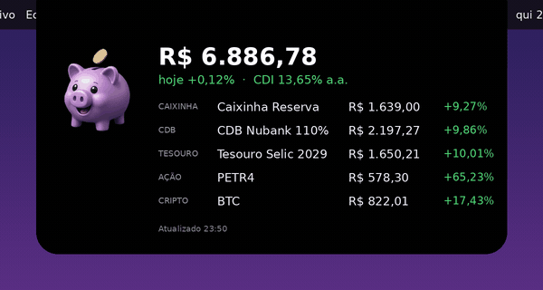<br/><a href="https://pilinvest.vercel.app">Ver demo</a>
</td>
</tr>
<tr>
<td width="50%" valign="top">
<h3>🥚 SatoshiPet</h3>
Bichinho em pixel art que flutua na tela (ou no terminal) e muda de humor com o mercado cripto.<br/><br/>
  <br/><br/>
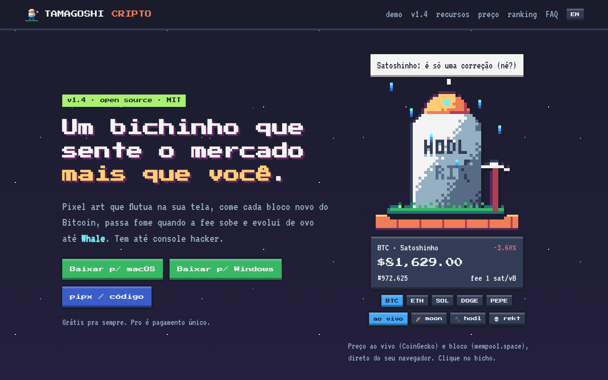
</td>
<td width="50%" valign="top">
<h3>🌱 Onedayzinho</h3>
Mais um morador do notch, nativo e caprichado nos detalhes.<br/><br/>
  <br/><br/>
<picture><source media="(prefers-color-scheme: dark)" srcset="./assets/projetos/sem-print-dark.svg"/><source media="(prefers-color-scheme: light)" srcset="./assets/projetos/sem-print-light.svg"/>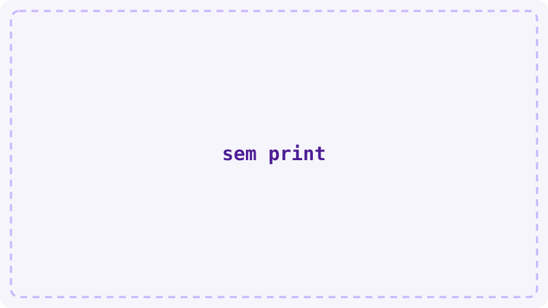</picture>
</td>
</tr>
<tr>
<td width="50%" valign="top">
<h3>💌 Lembrar que te amo</h3>
Capivarinha que mora na borda da tela do Mac e sai para entregar um bilhetinho (há também um bilhete do dia, offline).<br/><br/>
   <br/><br/>
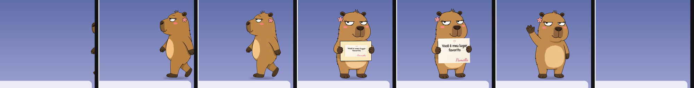
</td>
<td width="50%" valign="top">
<h3>🎮 Save Point</h3>
App de foco em estilo videogame para Mac e celular: cada tarefa é uma fase, cada pausa é um checkpoint.<br/><br/>
   <br/><br/>
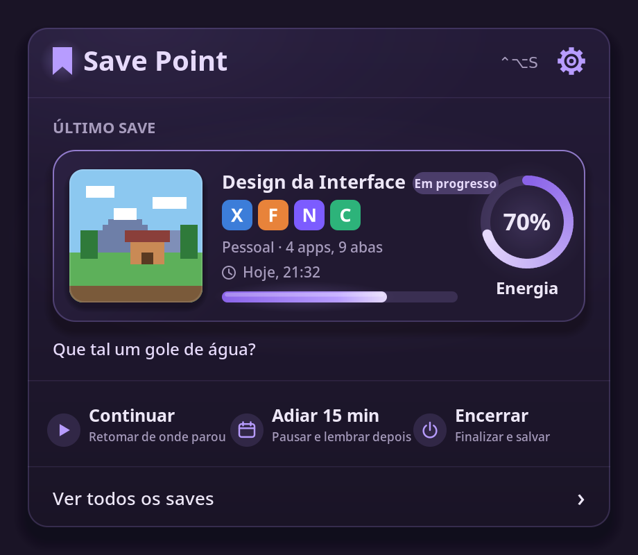
</td>
</tr>
<tr>
<td width="50%" valign="top">
<h3>💜 Kora</h3>
App da Pamella para autocuidado, treino e ciclo menstrual (treino adaptado ao ciclo).<br/><br/>
     <br/><br/>
<p align="center">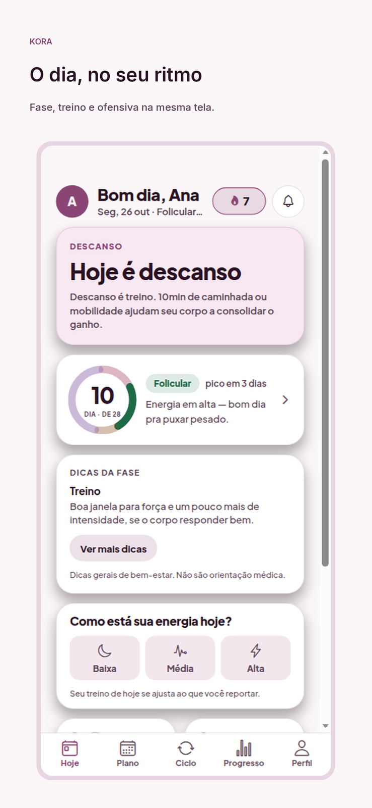</p>
</td>
<td width="50%" valign="top">
<h3>😴 Diário do Sono</h3>
App que registra o sono, calcula a qualidade da noite e cuida de um bichinho (lê dados do app Saúde, no iPhone).<br/><br/>
    <br/><br/>
<p align="center">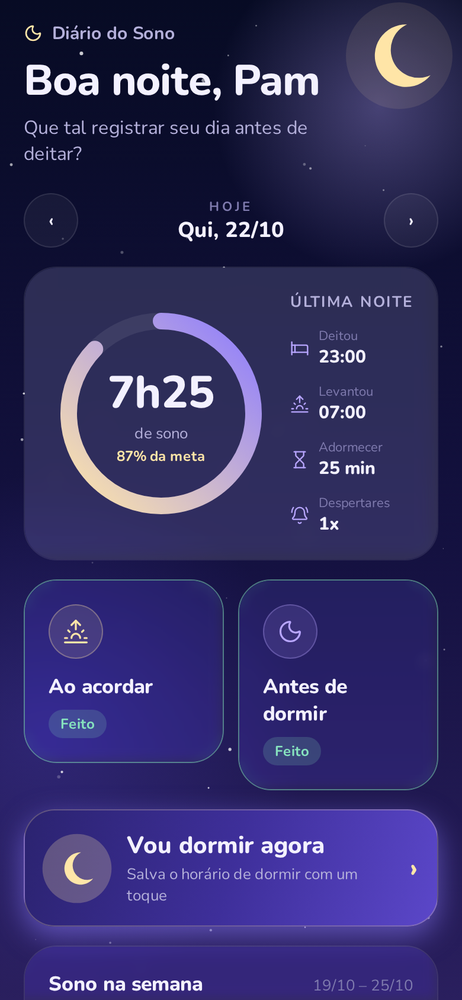</p>
</td>
</tr>
<tr>
<td width="50%" valign="top">
<h3>🕹️ Último em Pé</h3>
Jogo em Godot 4 com tela inicial para criar uma noite ou entrar com código; a rede online ainda é um stub local.<br/><br/>
 <br/><br/>
<p align="center">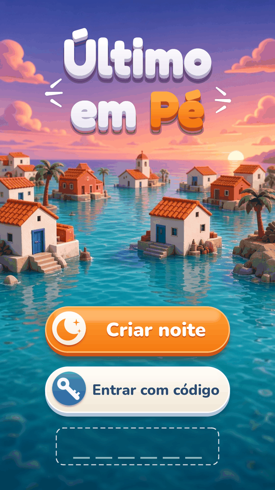</p>
</td>
<td width="50%" valign="top">
<h3>🗺️ Trilhas de Floripa</h3>
Jogo das trilhas de Florianópolis (Trilhas de Floripa / Trails Tai), com o mapa da ilha e fases baseadas nas trilhas.<br/><br/>
   <br/><br/>
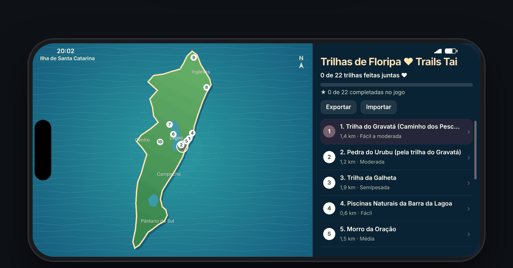
</td>
</tr>
<tr>
<td width="50%" valign="top">
<h3>💧 Tico</h3>
Central de pendências no entalhe do Mac: o Tico, uma gotinha amarela, mostra as pendências em espaços separados por trabalho.<br/><br/>
    <br/><br/>
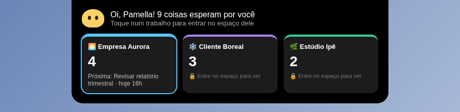
</td>
<td width="50%" valign="top">
<h3>💵 Lastro</h3>
PWA para guardar em dólar digital (USDC) e investir na carteira Mundo (BDR) via Pix a partir de R$ 10; no MVP, todos os parceiros são simulados.<br/><br/>
     <br/><br/>
<p align="center">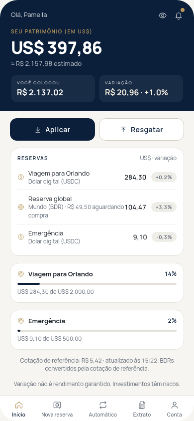</p>
</td>
</tr>
<tr>
<td width="50%" valign="top">
<h3>💊 Caixinha de remédios</h3>
Porta-comprimidos com ESP32, aviso local por LED e buzzer, e notificação à família via ntfy.sh (projeto pessoal, primeira usuária: a mãe dela).<br/><br/>
    <br/><br/>
<picture><source media="(prefers-color-scheme: dark)" srcset="./assets/projetos/sem-print-dark.svg"/><source media="(prefers-color-scheme: light)" srcset="./assets/projetos/sem-print-light.svg"/></picture>
</td>
<td width="50%" valign="top">
<h3>🏹 Clã da Presa</h3>
Jogo mobile de caçadores de recompensa da Borda Seca (caçar, quebrar couraça e levar material à forja), com servidor de salas para jogar online.<br/><br/>
   <br/><br/>
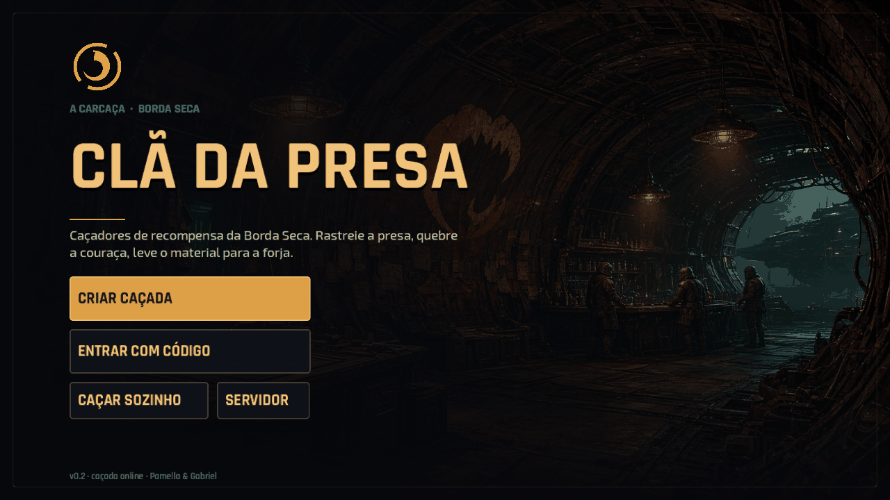
</td>
</tr>
<tr>
<td width="50%" valign="top">
<h3>🌤️ Day Care</h3>
Conceito visual de um app para montar um roteiro de pausa no dia (descoberta, reserva e pagamento), só com imagens e dados fictícios.<br/><br/>
 <br/><br/>
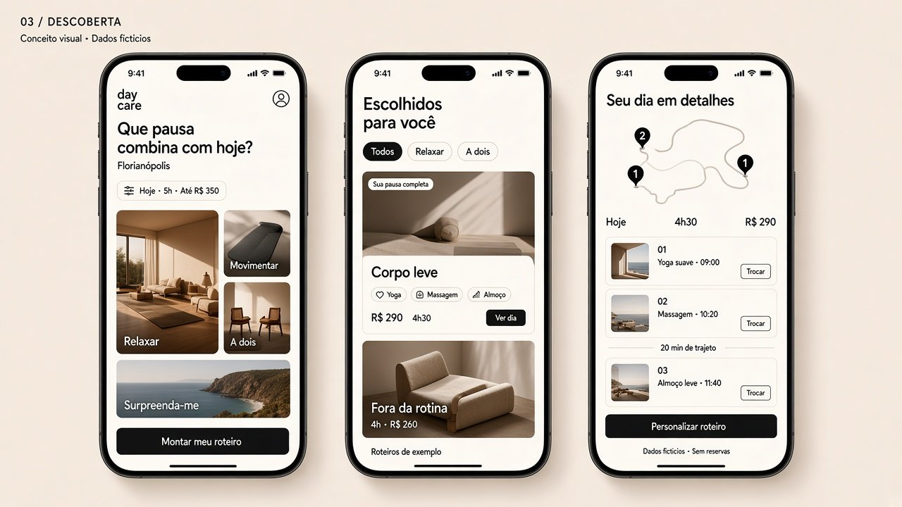
</td>
<td width="50%" valign="top">
<h3>🏅 App de atletas</h3>
Plataforma para atletas do Brasil buscarem bolsa esportiva nos EUA (feed, faculdades, times e bolsas; dados fictícios no protótipo).<br/><br/>
    <br/><br/>
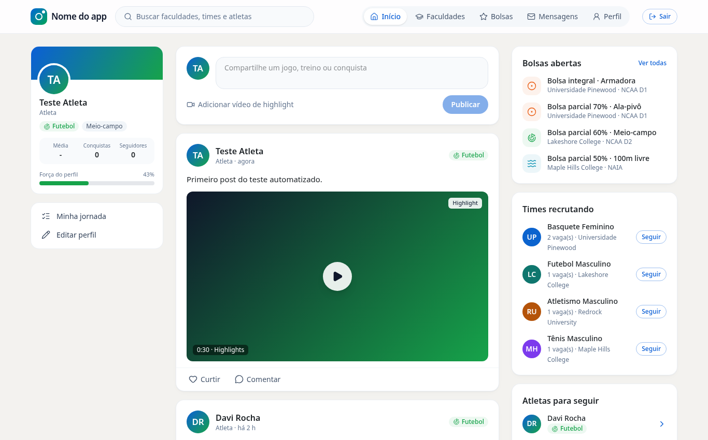
</td>
</tr>
</table>

<p align="center"></p>

## 🧪 Ferramentas do dia a dia

**Qualidade & testes**<br/>


**Dev**<br/>


<p align="center"></p>

## 📊 Placar

<p align="center">
  
  
</p>

<p align="center">
  <picture>
    <source media="(prefers-color-scheme: dark)" srcset="https://raw.githubusercontent.com/pamteech/pamteech/output/snake-dark.svg" />
    <source media="(prefers-color-scheme: light)" srcset="https://raw.githubusercontent.com/pamteech/pamteech/output/snake-light.svg" />
    
  </picture>
</p>

<p align="center"></p>

<p align="center"><sub>🐞 Se compila, eu testo. Se quebra, eu conto. Se fica lindo, eu comemoro.</sub></p>
<p align="center"></p>
